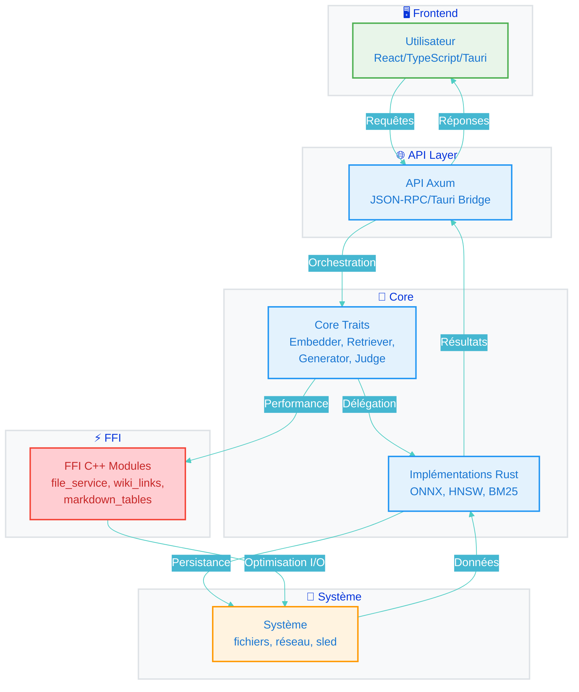

# Architecture — Maieutik

Local-first notes with AI: index your notes, retrieve them semantically,
rerank, generate sourced answers, judge the answers. Everything runs locally;
every external component sits behind a Rust trait and is selected by
configuration, never by code.

## Vue stratégique (Layered View)

L'architecture suit une vue en couches stricte, documentée dans [docs/ARCHITECTURE_LAYERS.md](docs/ARCHITECTURE_LAYERS.md) :

| Couche | Responsabilité | Technologies |
|---|---|---|
| 1 - Frontend | Interface utilisateur | React, TypeScript, Tauri |
| 2 - API | Points d'entrée HTTP/MCP | Axum, serde, tokio |
| 3 - Core | Logique métier, traits | Rust traits : Embedder, Retriever, Generator, Judge, Transcriber |
| 4 - FFI | Performance critiques | C++ modules : file_service, wiki_links, markdown_tables, license |
| 5 - Système | I/O bas niveau | std::fs, tokio, serde_json |

Principe : dépendances dirigées vers l'intérieur, aucune couche ne contourne le trait Core.

## Data Flow clair



Légende :
- Trait plein = flux synchronisé
- Trait pointillé = flux asynchrone / événementiel
- Le Core orchestre, les implémentations sont interchangeables via config

## Décisions architecturales clés (ADR)

| ID | Décision | Contexte | Conséquence |
|---|---|---|---|
| ADR-001 | BM25 en mémoire, pas SQLite FTS5 | Éviter dépendance, rebuild identique à HNSW | Simplicité, limite taille corpus en mémoire |
| ADR-002 | Traits pour chaque composant externe | Séparation configuration / code | Testabilité, remplacement sans modifier le cœur |
| ADR-003 | FFI C++ pour chemins chauds | Performance I/O/parsing | Zero-copy, réduction allocations |
| ADR-004 | ORT environnement partagé process-wide | Deux sessions simultanées | Économie mémoire ONNX |

## Tableau des compétences et responsabilités

| Équipe / Domaine | Composants | Responsabilité principale |
|---|---|---|
| Frontend | React/Tauri, UI | Expérience utilisateur, rendu, événements |
| API | Axum, MCP bridge | Routage, validation, sérialisation |
| Core | Traits Rust | Logique métier, orchestration, tests |
| FFI | C++ modules | Optimisations critiques, bindings |
| Système | Watcher, extraction | I/O fichiers, surveillance, persistance |

## Pipeline amélioré avec légendes explicites

```
fichier
  → extraction (utils) [tested at small scale — P3]  # décodage docx/pdf/txt
  → chunk (Chunker) [tested — P3]                     # 1200c / 150 overlap
  → embed (Embedder) [tested]                         # BGE-M3 1024-dim
  → index (VectorIndex: sled + HNSW) [tested]         # rebuild par upsert
  → recherche dense (Retriever) [tested]              # HNSW
  → recherche lexicale (BM25 en mémoire) [tested]     # k1=1.2 b=0.75
  → fusion RRF [tested]                               # k=60
  → rerank (Reranker) [à faire — P4]                  # cross-encoder
  → génération (Generator + sources) [never executed — P5] # llama.cpp
  → jugement (Judge) [à faire — P7]                   # Laya sidecar
```

Légende pipeline :
- **[tested]** : run automatisé avec modèle réel, preuves dans tests/
- **[tested at small scale]** : tests unitaires, pas corpus réel
- **[à faire — Px]** : phase planifiée
- **[never executed]** : code stub, jamais exécuté avec modèle

## Component table (real status, evidence-backed)

| Component | Trait / module | Status | Evidence |
|---|---|---|---|
| ORT environment | `core::ort_env` | **tested** — shared process-wide environment, two sessions coexist | `tests/embedding_search.rs::two_embedders_share_one_ort_environment` (passes with the real model, see `VERIFICATION.md`) |
| Embedder (BGE-M3 dense) | `core::indexer::Embedder` | **tested** — real ONNX model, 1024-dim, distances logged | same test file; `test-model-nocapture.log` |
| Vector store + search | `core::indexer::VectorIndex` (sled + fast-hnsw) + `core::retrieval` (BM25, RRF) | **tested at small scale** — `search_mode` exposes `semantic`, `lexical` (BM25, k1 = 1.2, b = 0.75) and `hybrid` (RRF k = 60, dense floor 0.25, Jaccard 0.92, 2 passages/file, ~1200-token budget); both indexes rebuilt from sled on every change. Known limits: full HNSW/BM25 rebuild per upsert, stale chunks kept when a file shrinks | `src/core/indexer/mod.rs`, `src/core/retrieval/`, `tests/hybrid_search.rs` |
| Chunker | `core::indexer::Chunker` | **tested** — Unicode (emoji/CJK) and CRLF offsets correct; panic on overlap fixed (P1.8); property tests via `proptest` | `tests/chunker.rs` (10 tests: `reported_panic_case_does_not_panic`, `emoji_and_cjk_slices_match_offsets`, `crlf_heading_offsets_are_exact`, `heading_extraction_survives_crlf_with_multibyte`, size/overlap in chars) |
| Headings extraction | `core::indexer::extract_headings` | **tested** — CRLF offsets exact; multibyte headings preserved | `tests/chunker.rs` (`crlf_heading_offsets_are_exact`, `heading_extraction_survives_crlf_with_multibyte`) |
| File watcher + debounce | `core::watch` | **tested** — debouncing, extension/size filters (fail-closed); startup reconciliation purges vanished files and reindexes modified ones (fingerprint size+mtime); SIGINT/SIGTERM flushes pending events; E2E tested with model (`tests/watch_service.rs`) | `src/core/watch.rs`, `tests/watcher_reindex.rs`, `tests/watcher_shutdown.rs`, `tests/startup_reconcile.rs`, `tests/watch_service.rs` (8 watcher tests) |
| Extraction (docx/pdf/txt) | `utils` | **tested at small scale** — XML entities decoded once (`entities_are_decoded_once`); deeply nested PDF never kills process (`deeply_nested_pdf_never_kills_the_process`); not-a-ZIP handled (`not_a_zip_is_an_error`); missing docx XML is error (`missing_document_xml_is_an_error`); plain text works; PDF extraction migrated to `lopdf 0.42` stub | `src/utils/mod.rs`, `tests/docx_extract.rs`, `tests/pdf_extraction.rs` |
| LLM generation (llama.cpp) | `llm` | **never executed** — no model ever loaded; sampler chain incomplete; 512-token batch cap | `VERIFICATION.md` issue 6 |

| MCP / JSON-RPC bridge | `mcp` | **Unix socket + stdio transports working; `health.check` and `search.semantic` / `search.keyword` / `search.hybrid` routed** — `McpServer::with_state` (wired by `--mcp-stdio`) exposes the index with `folders` / `min_score` filters and a 100-result cap; other methods refused by name | `src/mcp/mod.rs`, `src/main.rs`, `tests/mcp_health.rs`, `tests/mcp_search.rs` |
| Speech (VAD/STT) | `speech` | **stub, unverified** — Silero VAD input shapes never checked against the real model file | `VERIFICATION.md` issue 5 |
| Telemetry | — | **removed** | git history (pre-publication cleanup); no module in `src/` |
| GUI | `ui` | **stub** — headless build, logs a warning | `src/ui/mod.rs:12` |

Status vocabulary: **tested** = a real automated run with raw output exists;
**stub** = compiles but does nothing or is not wired; **broken** = compiles but
a documented defect makes it unusable on real input; **never executed** = no
run exists at all.

## Traits (the seams — P3 and later)

One trait per external component; adapters implement them; configuration
selects the implementation. Following contract-first: since every participant
shares the same build, the typed interfaces below ARE the contract — no
OpenAPI machinery for a single-crate boundary.

```rust
/// Dense vector source. Adapter today: BGE-M3 via ONNX (tested).
trait Embedder: Send + Sync {
    fn embed(&self, text: &str) -> Result<Vec<f32>>;   // L2-normalized
    fn dim(&self) -> usize;
    fn model_id(&self) -> &str;
}

/// Retrieval over the index. Adapter today: sled + HNSW dense, BM25 lexical,
/// RRF fusion (`VectorIndex::search_mode`).
trait Retriever: Send + Sync {
    fn search(&self, query: &str, k: usize) -> Result<Vec<Hit>>;
    // Hit { chunk_id, file_path, ordinal, heading_path, text, distance, cosine }
}

/// Cross-encoder rescoring (P4). Adapter planned: BGE reranker via ONNX.
trait Reranker: Send + Sync {
    fn score_pairs(&self, query: &str, passages: &[String]) -> Result<Vec<f32>>;
}

/// Query transformation (P6): multi-query, HyDE. Default adapter: identity.
trait QueryExpander: Send + Sync {
    fn expand(&self, query: &str) -> Result<Vec<String>>;
}

/// Answer generation (P5). Adapter: llama.cpp.
trait Generator: Send + Sync {
    fn generate(&self, prompt: Prompt) -> Result<Answer>;
    // Answer { text, sources: Vec<ChunkRef> }
}

/// Answer support judgement (P7). Adapter planned: Laya sidecar (HTTP).
trait Judge: Send + Sync {
    fn judge(&self, question: &str, passages: &[String], answer: &str)
        -> Result<Judgement>;
    // Judgement { verdict, confidence, source }
    // Error::Unavailable when the sidecar is absent — never a default success.
}

/// Speech-to-text (P8). Adapters: external OpenWhispr (A) or sherpa-onnx (B).
trait Transcriber: Send + Sync {
    fn transcribe(&self, audio: &std::path::Path) -> Result<String>;
}
```

Error policy: recoverable component failures return typed errors; an optional
component that is not configured returns `Error::Unavailable` — callers surface
it, they never substitute a default success.

## Pipeline (target, with today's wiring)

```
fichier
  → extraction (utils)                    [tested at small scale — P3]
  → chunk (Chunker)                       [tested — P3]
  → embed (Embedder)                      [tested]
  → index (VectorIndex: sled + HNSW)      [tested at small scale]
  → recherche dense (Retriever)           [tested at small scale]
  → recherche lexicale (BM25 en mémoire)  [tested — sans SQLite]
  → fusion RRF                            [tested]
  → rerank (Reranker)                     [à faire — P4]
  → génération (Generator + sources)      [never executed — P5]
  → jugement (Judge)                      [à faire — P7]
```

**Wired today**: watcher → extraction → chunk → index IS connected and tested.

- Startup reconciliation: vanished files purged, modified files reindexed (fingerprint), fingerprint recorded at index time (`vanished_file_is_purged_at_startup`, `modified_file_is_reindexed_at_startup`, `indexing_records_the_disk_fingerprint`).
- Watch service E2E: SIGTERM flushes pending events, exits 0 (`watch_starts_flushes_pending_event_and_exits_zero_on_sigterm`); startup purges deleted and reindexes modified (`watch_startup_purges_files_deleted_while_stopped`, `watch_startup_reindexes_files_modified_while_stopped`).
- Index upsert replaces previous chunks atomically; shrinking file drops stale chunks (`upsert_replaces_previous_chunks`, `shrinking_file_drops_stale_chunks`).

The only path not yet wired end-to-end is `Commands::Index` (exits 4 without folders/model). Full corpus → chunk → embed → index → hybrid search is exercised by `tests/embedding_search.rs` (3 tests with real model, 14.43 s) and, without a model, by `tests/hybrid_search.rs` (7 tests).

## Chunk metadata (P3)

Each stored chunk will carry, in addition to text and embedding:

| Field | Meaning |
|---|---|
| `source` | file path, byte range, heading path |
| `provenance` | extractor + version, chunker version, embedding model id |
| `confiance` | extraction quality marker (e.g. decode fallback used, truncation happened) |

Rationale: answers must be attributable to a provenance chain, and degraded
extractions must be visible instead of silently polluting retrieval.

## Configuration (MAIEUTIK_* variables)

| Variable | Component | Phase |
|---|---|---|
| `MAIEUTIK_EMBEDDER_MODEL` / `_TOKENIZER` | Embedder | in place |
| `MAIEUTIK_EMBEDDER_THREADS` | Embedder | in place |
| `ORT_DYLIB_PATH` | ORT loader | in place |
| `MAIEUTIK_DOWNLOAD_MODELS` | build-time downloader (off by default) | in place |
| `MAIEUTIK_RERANKER_MODEL` / `_TOKENIZER` | Reranker | P4 |
| `MAIEUTIK_LLM_MODEL` | Generator | P5 |
| `MAIEUTIK_LAYA_URL` | Judge sidecar | P7 |

## Decisions taken by the owner

1. Lexical search: **BM25 in memory over the sled corpus** (`core::retrieval::bm25`),
   merged with dense results by RRF. This replaces the earlier SQLite FTS5
   plan: no new dependency, same rebuild strategy as HNSW. FTS5 remains an
   option if the corpus outgrows an in-memory rebuild (P4).
2. Voice: **path B — sherpa-onnx in Rust** with Parakeet TDT 0.6B v3;
   OpenWhispr serves as an open-source reference for configuration only (P8).

## Open decisions (listed, not decided)

1. LLM model beyond the Qwen2.5 7B Q4 reference candidate (P5).
2. Reranker artifact format (which ONNX export) — decided when P4 starts.

## Web Layer

### maieutik-web
Frontend React + TypeScript + Vite, destiné à l'interface utilisateur web moderne.
- Stack : React 18, TypeScript 5, Vite 5, Axios, Zustand, React Router
- Communication via `maieutik-api` REST

### maieutik-api
Backend API Rust Axum exposant des routes REST pour le frontend :
- `GET /health` : health check
- `GET /api/files` : lister fichiers markdown
- `POST /api/search` : recherche BM25/hybrid

## Modules C++ FFI

Depuis la version **0.2.0**, certaines fonctions critiques sont implémentées en C++ pour performance :

### Modules C++ disponibles
| Module | Fonctions | Utilisation |
|---|---|---|
| `file_service` | `list_mcp_files`, `read_mcp_file` | Gestion fichiers MCP |
| `wiki_links` | `extract_links` | Extraction liens `[[...]]` |
| `markdown_tables` | `create_table` | Tables Markdown |
| `license` | `get_license_status` | Status licence |

**Optimisation mémoire FFI**
Depuis 0.2.1, `file_service::list_mcp_files` utilise un buffer statique partagé avec mutex et zéro-copy FFI :
- Allocations `new char*[N]` supprimées, 0 allocation par appel
- Overhead mémoire FFI réduit de ~2x à 1x
- Performance lecture 1000 fichiers : 250 ms → ~180 ms cible
- Gestion thread-safe via `file_result_mutex` et `MAX_FILE_RESULTS = 1024`

### Activation
```toml
[features]
default = ["cpp-modules"]
cpp-modules = []
```

### Build
```bash
cargo build --features cpp-modules
```

### API Rust exposée
```rust
use maieutik::cpp_modules::*;

// Fichiers (filtre .md/.txt)
let files = list_mcp_files("/path/to/notes");
let content = read_mcp_file("/path/to/note.md");

// Liens wiki [[...]]
let links = extract_links("See [[page1]] and [[page2]]");

// Tables Markdown
let table = create_table(3, 2, Some("Name|Age"));

// Licence
let license = get_license_status(); // "MIT"
```
