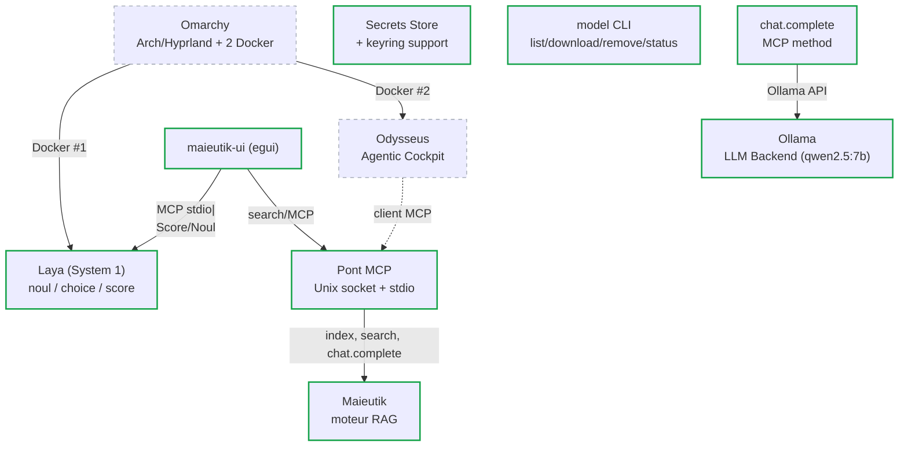

# Maieutik

[](https://blog.rust-lang.org/)
[](https://opensource.org/licenses/MIT)
[](https://github.com/modelcontextprotocol/rust-sdk)

> Maieutik est un moteur de prise de notes local avec IA. Il permet d'indexer vos notes, de les retrouver par similarité sémantique, et de générer des réponses sourcées. Tout s'exécute localement.

---

## 📚 Table des matières

- [Vue d'ensemble](#-vue-densemble)
- [Installation](#-installation)
- [Démarrage rapide](#-démarrage-rapide)
- [Architecture](#-architecture)
- [Commandes principales](#-commandes-principales)
- [Statut du projet](#-statut-du-projet)
- [Prérequis](#-prérequis)
- [Tests](#-tests)
- [Limites connues](#-limites-connues)
- [Licence](#-licence)

---

## 🚀 Vue d'ensemble

Maieutik (grâce à sa manière de penser, inspirée par Socrate) est un système de prise de notes **local-first** qui combine :

- **Indexation RAG** : Recherche par similarité sémantique avec embeddings BGE-M3
- **Gestion de modèles** : CLI pour lister, télécharger, et gérer les modèles LLM
- **MCP Bridge** : Pont JSON-RPC natif pour intégration avec d'autres systèmes
- **Chat avec Ollama** : Génération de réponses via backend Ollama local

**Architecture hybride** : Maieutik (moteur RAG) + Laya (System 1) + maieutik-ui (client egui) + Odysseus (hors dépôt) + Omarchy (environnement dédié).

---

## 📦 Installation

Voir le guide complet dans [maieutik/docs/INSTALLATION.md](maieutik/docs/INSTALLATION.md).

```sh
git clone https://github.com/chelmooz/maieutik
cd maieutik
scripts/release.sh
```

### Configuration

1. Installez onnxruntime 1.31.0
2. Téléchargez le modèle BGE-M3 ONNX (model.onnx, model.onnx_data, tokenizer.json)
3. Configurez votre dossier de notes dans `~/.config/maieutik/config.json`

---

## 🏃 Démarrage rapide

```sh
# Indexer vos notes
maieutik index

# Rechercher dans vos notes
maieutik search "ma question"

# Utiliser le chat avec Ollama
MAIEUTIK_LLM_MODEL="ollama://qwen2.5:7b" maieutik chat "Explique RAG"
```

---

## 🧩 Architecture



---

## ⌨️ Commandes principales

```sh
# Indexer les dossiers configurés
maieutik index [--force]

# Rechercher
maieutik search "requête" [--limit 10]

# Mode service : surveille les dossiers jusqu'à SIGINT/SIGTERM
maieutik --watch

# Model management (P0)
maieutik model list
maieutik model download <nom>
maieutik model remove <nom> [--force]
maieutik model status <nom>

# Chat avec Ollama (P3)
MAIEUTIK_LLM_MODEL="ollama://qwen2.5:7b" maieutik chat "Quel est le concept de RAG ?"
```

---

## 📊 Statut du projet

| Élément | Statut | Tests |
|---------|--------|-------|
| Secrets Store | ✅ Implémenté | 7 tests |
| Model CLI | ✅ Implémenté | 6 tests |
| Download Manager | ✅ Implémenté | 6 tests |
| Model Installer | ✅ Implémenté | 3 tests |
| Indexation BGE-M3 | ✅ Fonctionnel | Intégration réelle |
| Recherche HNSW/BM25 | ✅ Fonctionnel | Tests P2 |
| Chat Ollama CLI | ✅ Fonctionnel | Testé en bout |
| Chat MCP (P3) | ✅ Fonctionnel | Testé JSON-RPC |

---

## 📋 Prérequis

- Rust 1.99.1+
- onnxruntime 1.31.0
- Modèle BGE-M3 ONNX (2.27 GB)
- Ollama (optionnel, pour le chat)

---

## 🧪 Tests

```sh
# Sans modèle
cargo test --locked

# Avec le modèle réel
cargo test --locked -- --ignored --nocapture --test-threads=1
```

---

## ⚠️ Limites connues

- Le modèle BGE-M3 fait 2.27 GB pour `model.onnx_data`
- La recherche hybride utilise RRF (k=60) sans recalibrage fin
- Le verrou d'instance est global au poste (socket abstrait)

---

## 📄 Licence

- **Licence** : MIT (`LICENSE`)
- **Dépôt** : https://github.com/chelmooz/maieutik
- **Avis tiers** : `THIRD_PARTY_NOTICES.md`

---

*Guide d'utilisation détaillé* : [maieutik/docs/UTILISATION.md](maieutik/docs/UTILISATION.md) | [Installation complète](maieutik/docs/INSTALLATION.md)