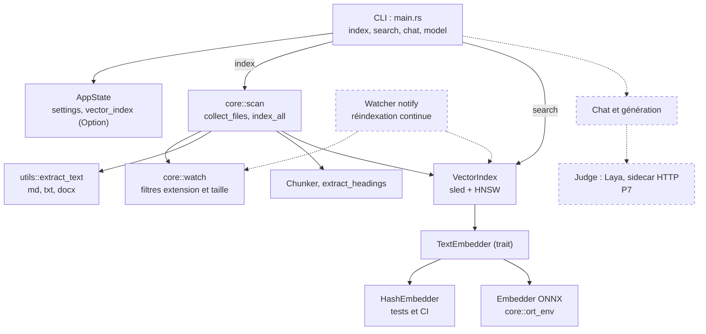

# Maieutik

Maieutik — prise de notes locale avec IA : indexation sémantique, recherche, génération de réponses sourcées, jugement des réponses. Tout s'exécute localement ; chaque composant externe se trouve derrière un trait Rust et est sélectionné par configuration, jamais par code.

## État du projet

| Fonction | Statut | Où |
|---|---|---|
| Indexation en ligne de commande (`index`) | Implémenté | `src/main.rs`, `core::scan` (si P1.14 fusionné) / `core::watch` |
| Recherche sémantique (`search`) | Implémenté | `src/main.rs`, `core::indexer::VectorIndex::search` |
| Chat / génération (`chat`) | Prévu (stub) | `src/main.rs`, `llm::LocalLlamaProvider` |
| Gestion modèles (`model`) | Prévu (stub) | `src/main.rs` |
| Extraction texte (md, txt, docx) | Implémenté | `utils::extract_text` |
| Découpage en chunks (Chunker) | Implémenté (avec limites) | `core::indexer::Chunker`, `extract_headings` |
| Embedding ONNX (BGE-M3) | Implémenté | `core::indexer::Embedder`, `core::ort_env` |
| Faux embedder déterministe (tests) | Implémenté | `core::indexer::HashEmbedder` |
| Index vectoriel (sled + HNSW) | Implémenté | `core::indexer::VectorIndex`, `sled`, `fast-hnsw` |
| Watcher fichiers (notify) | Prévu (stub) | `core::watch::FileWatcher` |
| MCP / JSON-RPC | Prévu (stub) | `mcp` |
| Speech (VAD/STT) | Prévu (stub) | `speech` |
| Interface graphique | Prévu (stub) | `ui` |
| Reranker (P4) | Prévu | — |
| Génération réponse (P5) | Prévu | `llm::Generator` (trait) |
| Jugement réponse (P7) | Prévu | `llm::Judge` (trait), Laya sidecar |
| Speech-to-text (P8) | Prévu | `speech::Transcriber` (trait) |

## Architecture



**Légende** : trait plein = implémenté ; pointillé = prévu / stub.  
Note : le module `core::scan` (collect_files, index_all) a été ajouté dans le lot P1.14 ; sur la branche `main` actuelle (P1.13), le parcours des dossiers est assuré par `core::watch` (filtres d'extension et taille) et l'indexation directe via `VectorIndex`.

## Commandes CLI

```sh
# Indexer les dossiers configurés
maieutik index [--force]
# Codes de sortie :
#   0 = tout indexé
#   1 = au moins un échec (fichier illisible, etc.) — l'ancien contenu du fichier est conservé
#   2 = modèle d'embedding absent ou aucun dossier configuré

# Rechercher
maieutik search "requête" [--limit 10]

# Chat (stub)
maieutik chat "message" [--file PATH]

# Modèles (stub)
maieutik model list|download|remove|status
```

- `index --force` : purge l'index (supprime aussi les fichiers disparus) puis reconstruit l'index complet.
- `index` sans `--force` : indexe les fichiers trouvés, remplace les fichiers modifiés, conserve les fichiers non trouvés.
- `search` : retourne les meilleurs résultats avec score (distance euclidienne sur vecteurs normalisés L2).
- `chat` et `model` : commandes factices (stubs) — non implémentées.

## Tests

```sh
# Sans modèle (tests unitaires et d'intégration sans ONNX)
cargo test --locked

# Avec modèle réel (nécessite MAIEUTIK_EMBEDDER_MODEL, MAIEUTIK_EMBEDDER_TOKENIZER, ORT_DYLIB_PATH)
MAIEUTIK_EMBEDDER_MODEL=… MAIEUTIK_EMBEDDER_TOKENIZER=… ORT_DYLIB_PATH=… \
  cargo test --locked -- --ignored --nocapture --test-threads=1
```

Voir `VERIFICATION.md` pour les logs et seuils détaillés.

## Licence / Liens

- Licence : MIT (voir `LICENSE`)
- Dépôt : https://github.com/chelmooz/maieutik
- Avis tiers : `THIRD_PARTY_NOTICES.md`