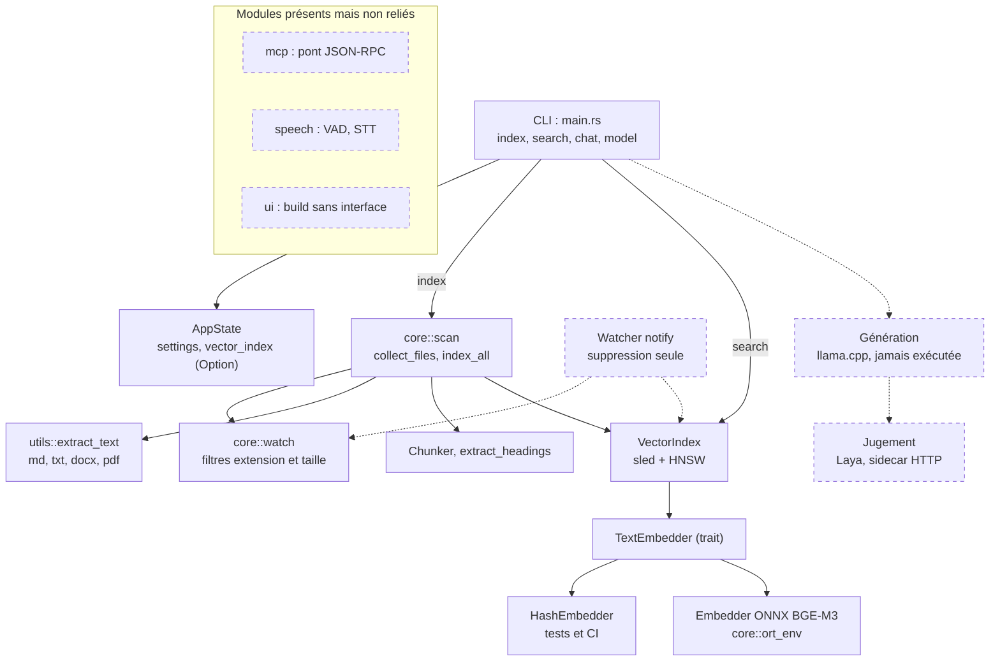

# Maieutik

Prise de notes locale avec IA : indexer ses notes, les retrouver par similarité sémantique et, à terme, reclasser les résultats, générer des réponses sourcées et juger ces réponses. Tout s'exécute localement ; chaque composant externe est placé derrière un trait Rust et choisi par configuration, jamais par le code.

Statut : expérimental. Seules l'indexation et la recherche fonctionnent de bout en bout. Le reste est en stub ou prévu (voir le tableau ci-dessous).

## État du projet

| Fonction | Statut | Où |
|---|---|---|
| Indexation par lot (`index`, `--force`) | Implémenté, testé sans modèle | `src/core/scan.rs`, `tests/index_scan.rs` |
| Parcours des dossiers (extensions, taille, liens symboliques ignorés) | Implémenté, testé | `src/core/scan.rs`, `src/core/watch.rs` |
| Recherche (`search`) | Implémenté | `src/main.rs`, `src/core/indexer/mod.rs`, `tests/index_search.rs` |
| Index vectoriel (sled + HNSW) | Implémenté, testé | `src/core/indexer/mod.rs`, `tests/index_replace.rs` |
| Embedder ONNX BGE-M3 (1024 dimensions) | Implémenté ; tests avec modèle non rejoués depuis plusieurs lots | `src/core/indexer/mod.rs`, `src/core/ort_env.rs`, `tests/embedding_search.rs` |
| Faux embedder déterministe (tests, CI) | Implémenté | `src/core/indexer/mod.rs` (`HashEmbedder`) |
| Extraction md, txt, docx | Implémenté, testé | `src/utils/mod.rs`, `tests/docx_extract.rs`, `tests/index_scan.rs` |
| Extraction pdf | Présente, non vérifiée | `src/utils/mod.rs` |
| Découpage en chunks | Implémenté, testé ; tailles fixes non calibrées | `src/core/indexer/mod.rs`, `tests/chunker.rs` |
| Surveillance de fichiers | Partielle : la suppression est traitée, la création et la modification sont journalisées sans réindexation | `src/core/watch.rs`, `src/lib.rs` |
| Génération (llama.cpp) | Stub : jamais exécutée avec un modèle | `src/llm/mod.rs` |
| Commandes `chat` et `model` | Factices | `src/main.rs` |
| Pont MCP / JSON-RPC | Stub | `src/mcp/mod.rs` |
| Voix (VAD, reconnaissance vocale) | Stub | `src/speech/mod.rs` |
| Interface graphique | Stub : build sans interface | `src/ui/mod.rs` |
| Reclassement, recherche lexicale avec fusion, jugement des réponses (Laya, sidecar HTTP), reconnaissance vocale | Prévu | `ARCHITECTURE.md` |

## Architecture



Légende : trait plein = implémenté et relié ; pointillé = partiel, stub ou prévu.

## Commandes

```sh
# Indexer les dossiers configurés
maieutik index [--force]

# Rechercher
maieutik search "requête" [--limit 10]

# Factices : affichent un message et sortent en code 0
maieutik chat "message" [--file CHEMIN]
maieutik model list | download NOM | remove NOM | status
```

Les dossiers à indexer se déclarent dans `config.json` (clé `Folders`).

### `index`

- Parcourt les dossiers configurés selon les extensions autorisées et la taille maximale, sans suivre les liens symboliques.
- Un fichier en erreur est journalisé et compté, il n'arrête pas le lot. Son ancien contenu dans l'index n'est pas purgé, sauf avec `--force`.
- L'index HNSW est reconstruit une seule fois, à la fin du lot.
- Sans `--force` : chaque fichier trouvé est remplacé sur place ; les fichiers disparus restent dans l'index.
- Avec `--force` : l'index est purgé avant l'indexation, ce qui retire aussi les fichiers disparus. Un fichier en échec perd alors son ancien contenu.
- Taille de chunk : 1200 caractères, recouvrement 150 (valeurs non calibrées).

Codes de sortie :

| Code | Signification |
|---|---|
| 0 | tout est indexé |
| 1 | au moins un échec : fichier illisible, ou dossier configuré introuvable ou non lisible |
| 2 | modèle d'embedding absent ou illisible, ou aucun dossier configuré |

### `search`

Affiche, pour chaque résultat, un score, le chemin et les 100 premiers caractères du chunk. L'index HNSW utilise la distance euclidienne sur des vecteurs normalisés L2. Si l'index vectoriel n'est pas initialisé (modèle absent), la commande affiche « Vector index not initialized » et sort en code 0.

## Prérequis

Documentés précédemment sur Arch Linux, non rejoués pour cette réécriture : Rust (1.99.1 testé), cmake, clang, pkg-config.

- onnxruntime 1.31.0 (version testée), chargé dynamiquement via `ORT_DYLIB_PATH`.
- Modèle BAAI/bge-m3, export ONNX officiel fp32 : `model.onnx` et `model.onnx_data` (2,27 Go) dans le même dossier, plus `tokenizer.json`. Les empreintes SHA-256 sont dans `VERIFICATION.md`.
- Le modèle n'est nécessaire que pour `index` et `search` en conditions réelles et pour les tests avec modèle. Les tests sans modèle utilisent `HashEmbedder`.

### Variables d'environnement

| Variable | Rôle |
|---|---|
| `MAIEUTIK_EMBEDDER_MODEL` | chemin de `model.onnx` (défaut : `bge-m3/model.onnx` dans le dossier des modèles) |
| `MAIEUTIK_EMBEDDER_TOKENIZER` | chemin de `tokenizer.json` (défaut : `bge-m3/tokenizer.json` dans le dossier des modèles) |
| `MAIEUTIK_EMBEDDER_THREADS` | nombre de threads intra-op (défaut : parallélisme de la machine) |
| `ORT_DYLIB_PATH` | chemin de `libonnxruntime.so` |
| `MAIEUTIK_DOWNLOAD_MODELS` | à la compilation seulement, `1` fait télécharger de petits modèles par `build.rs` (désactivé par défaut) |

## Tests

```sh
# Sans modèle
cargo test --locked

# Avec le modèle réel (nécessite les variables ci-dessus)
cargo test --locked -- --ignored --nocapture --test-threads=1
```

`VERIFICATION.md` décrit ce qui a été exécuté et les empreintes des fichiers. Ses journaux avec modèle sont antérieurs à plusieurs lots et n'ont pas été rejoués.

## Limites connues

- Réindexation continue : le watcher ne réindexe pas les fichiers créés ou modifiés.
- `chat` et `model` sont factices et sortent en code 0.
- La génération n'a jamais chargé de modèle dans cet environnement.
- Le seuil de distance des tests avec modèle (`tests/embedding_search.rs`) a été calibré sur un modèle antérieur, d'après `VERIFICATION.md`.
- Découpage : les deux défauts signalés par `ARCHITECTURE.md` (panique sur texte non ASCII avec recouvrement, positions de titres fausses avec CRLF) ont des tests de non-régression dans `tests/chunker.rs`, qui passent. `ARCHITECTURE.md` n'a pas été mis à jour : il décrit encore le découpage comme cassé et `index` comme un stub vide.
- Extraction pdf : les avis de sécurité sur `lopdf` (via `pdf-extract`) et sur `failure` (via `single-instance`) sont ignorés de façon documentée dans `.cargo/audit.toml`, avec revue prévue.
- Les sorties du modèle sont denses seulement : les sorties sparse et ColBERT de BGE-M3 sont absentes de l'export ONNX utilisé.

## Licence et liens

- Licence : MIT (`LICENSE`)
- Dépôt : https://github.com/chelmooz/maieutik
- Avis tiers : `THIRD_PARTY_NOTICES.md`