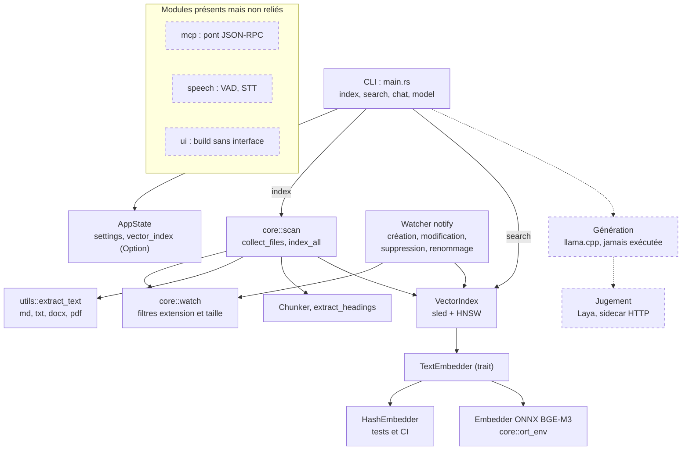

# Maieutik

Prise de notes locale avec IA : indexer ses notes, les retrouver par similarité sémantique et, à terme, reclasser les résultats, générer des réponses sourcées et juger ces réponses. Tout s'exécute localement ; chaque composant externe est placé derrière un trait Rust et choisi par configuration, jamais par le code.

Statut : expérimental. Seules l'indexation et la recherche fonctionnent de bout en bout. Le reste est en stub ou prévu (voir le tableau ci-dessous).

## État du projet

| Fonction | Statut | Où |
|---|---|---|
| Indexation par lot (`index`, `--force`) | Implémenté, testé sans modèle | `src/core/scan.rs`, `tests/index_scan.rs` |
| Parcours des dossiers (extensions, taille, liens symboliques ignorés) | Implémenté, testé | `src/core/scan.rs`, `src/core/watch.rs` |
| Recherche (`search`) | Implémenté | `src/main.rs`, `src/core/indexer/mod.rs`, `tests/index_search.rs` |
| Index vectoriel (sled + HNSW) | Implémenté, testé | `src/core/indexer/mod.rs`, `tests/index_replace.rs` |
| Embedder ONNX BGE-M3 (1024 dimensions) | Implémenté ; tests avec modèle non rejoués depuis plusieurs lots | `src/core/indexer/mod.rs`, `src/core/ort_env.rs`, `tests/embedding_search.rs` |
| Faux embedder déterministe (tests, CI) | Implémenté | `src/core/indexer/mod.rs` (`HashEmbedder`) |
| Extraction md, txt, docx | Implémenté, testé | `src/utils/mod.rs`, `tests/docx_extract.rs`, `tests/index_scan.rs` |
| Extraction pdf | Présente ; chaîne corrigée au P1.17 (`pdf-extract 0.12` → `lopdf 0.42`, RUSTSEC-2026-0187 levé), PDF hostile régressé ; non vérifiée sur un corpus réel | `src/utils/mod.rs`, `tests/pdf_extraction.rs` |
| Découpage en chunks | Implémenté, testé ; tailles fixes non calibrées | `src/core/indexer/mod.rs`, `tests/chunker.rs` |
| Surveillance de fichiers (`maieutik --watch`) | Implémentée : création, modification, suppression et renommage réindexent (validation extension + taille fail-closed) ; arrêt sur `SIGINT`/`SIGTERM` qui vide les événements en attente avant de sortir en 0 ; testée sans modèle et de bout en bout avec modèle (`tests/watch_service.rs`, ignoré par défaut). Un événement survenu pendant un arrêt du processus n'est pas rattrapé : relancer `maieutik index` | `src/core/watch.rs`, `src/lib.rs`, `src/main.rs`, `tests/watcher_reindex.rs`, `tests/watcher_shutdown.rs`, `tests/watch_service.rs` |
| Génération (llama.cpp) | Stub : jamais exécutée avec un modèle. Le découpage du prompt par lots et le plafonnement de la génération au contexte sont calculés et testés (`plan_decode`), pas encore exercés par une vraie génération | `src/llm/mod.rs` |
| Commandes `chat` et `model` | Factices | `src/main.rs` |
| Pont MCP / JSON-RPC | Stub | `src/mcp/mod.rs` |
| Voix (VAD, reconnaissance vocale) | Prévu ; stub sans moteur — `sherpa-onnx` (feature `stt`, jamais activée) retiré au P1.19 avec les avis de sécurité qu'il trainait | `src/speech/mod.rs` |
| Interface graphique | Stub : build sans interface | `src/ui/mod.rs` |
| Reclassement, recherche lexicale avec fusion, jugement des réponses (Laya, sidecar HTTP), reconnaissance vocale | Prévu | `ARCHITECTURE.md` |

## Architecture



Légende : trait plein = implémenté et relié ; pointillé = partiel, stub ou prévu.

## Commandes

```sh
# Indexer les dossiers configurés
maieutik index [--force]

# Rechercher
maieutik search "requête" [--limit 10]

# Mode service : surveille les dossiers jusqu'à SIGINT/SIGTERM
maieutik --watch

# Factices : message sur stderr, code de sortie 3 (non implémentées)
maieutik chat "message" [--file CHEMIN]
maieutik model list | download NOM | remove NOM | status
```

Les dossiers à indexer se déclarent dans `config.json`, sous `settings.Folders` (liste de chemins). Les clés du bloc `settings` sont en PascalCase (`Folders`, `Extensions`, `MaxFileSize`). **Guide d'utilisation détaillé :** [docs/UTILISATION.md](docs/UTILISATION.md).

### `--watch` (mode service)

`maieutik --watch` garde le processus au premier plan, surveille `settings.Folders` et réindexe créations, modifications, suppressions et renommages. Il s'arrête sur `SIGINT` (Ctrl-C) ou `SIGTERM`, après avoir vidé les événements encore en attente dans la fenêtre de débounce (2 s) : un fichier modifié juste avant l'arrêt est réindexé, puis le processus sort en 0.

- Sans `--watch`, le comportement est inchangé : une commande s'exécute et le processus sort.
- `--watch` refuse de démarrer (code 4) s'il n'y a aucun dossier configuré ou si l'index est indisponible (modèle d'embedding absent ou illisible) : le service ne tourne pas s'il ne peut jamais réindexer.
- `--watch` combiné à une sous-commande ou à `--mcp-stdio` est une erreur d'usage (code 2).
- Le verrou d'instance unique s'applique : deux `--watch` simultanés ne peuvent pas tourner.

### `index`

- Parcourt les dossiers configurés selon les extensions autorisées et la taille maximale, sans suivre les liens symboliques.
- Un fichier en erreur est journalisé et compté, il n'arrête pas le lot. Un fichier sans texte extractible est signalé sur stderr (« sans texte : chemin ») et compté à part ; un corpus vide donne aussi le code 1. Le résumé final a la forme « N indexé(s), M sans texte, K échec(s) ».
- L'index HNSW est reconstruit une seule fois, à la fin du lot.
- Sans `--force` : chaque fichier trouvé est remplacé sur place ; les fichiers disparus restent dans l'index.
- Avec `--force` : chaque fichier trouvé remplace ses passages, puis les fichiers disparus sont retirés. L'index n'est jamais purgé d'un bloc : un fichier en échec d'extraction garde son ancien contenu et est compté comme échec.
- Taille de chunk : 1200 caractères, recouvrement 150 (valeurs non calibrées).

Codes de sortie :

| Code | Signification |
|---|---|
| 0 | tout est indexé, aucun fichier sans texte, corpus non vide ; ou arrêt propre demandé par `SIGINT`/`SIGTERM` en `--watch` |
| 1 | échec partiel : fichier en échec, fichier sans texte, corpus vide, ou dossier configuré introuvable ou non lisible |
| 2 | erreur d'usage : sous-commande inconnue, `--limit 0`, `--watch` combiné à une sous-commande ou à `--mcp-stdio` |
| 3 | commande non implémentée : chat, model, mcp |
| 4 | index indisponible : aucun dossier configuré, aucun dossier lisible, ou modèle d'embedding absent ou illisible (cas de `index`, `search` et `--watch`) |

### `search`

Affiche, pour chaque résultat, un score, le chemin et les 100 premiers caractères du chunk. L'index HNSW utilise la distance euclidienne sur des vecteurs normalisés L2. Si l'index est indisponible (modèle absent ou illisible), la commande écrit « Index indisponible » sur stderr, laisse stdout vide et sort en code 4. `--limit 0` est refusé avec le code 2.

## Prérequis

Documentés précédemment sur Arch Linux, non rejoués pour cette réécriture : Rust (1.99.1 testé), cmake, clang, pkg-config.

- onnxruntime 1.31.0 (version testée), chargé dynamiquement via `ORT_DYLIB_PATH`.
- Modèle BAAI/bge-m3, export ONNX officiel fp32 : `model.onnx` et `model.onnx_data` (2,27 Go) dans le même dossier, plus `tokenizer.json`. Les empreintes SHA-256 sont dans `VERIFICATION.md`.
- Le modèle n'est nécessaire que pour `index` et `search` en conditions réelles et pour les tests avec modèle. Les tests sans modèle utilisent `HashEmbedder`.

### Variables d'environnement

| Variable | Rôle |
|---|---|
| `MAIEUTIK_EMBEDDER_MODEL` | chemin de `model.onnx` (défaut : `bge-m3/model.onnx` dans le dossier des modèles) |
| `MAIEUTIK_EMBEDDER_TOKENIZER` | chemin de `tokenizer.json` (défaut : `bge-m3/tokenizer.json` dans le dossier des modèles) |
| `MAIEUTIK_EMBEDDER_THREADS` | nombre de threads intra-op (défaut : parallélisme de la machine) |
| `ORT_DYLIB_PATH` | chemin de `libonnxruntime.so` |
| `MAIEUTIK_DOWNLOAD_MODELS` | à la compilation seulement, `1` fait télécharger de petits modèles par `build.rs` (désactivé par défaut) |

## Tests

```sh
# Sans modèle
cargo test --locked

# Avec le modèle réel (nécessite les variables ci-dessus)
cargo test --locked -- --ignored --nocapture --test-threads=1
```

`VERIFICATION.md` décrit ce qui a été exécuté et les empreintes des fichiers. Ses journaux avec modèle sont antérieurs à plusieurs lots et n'ont pas été rejoués.

## Limites connues

- Surveillance : un événement de fichier survenu pendant un arrêt de Maieutik n'est pas rattrapé au redémarrage (pas de réconciliation au démarrage) ; relancer `maieutik index` pour réaligner l'index. L'arrêt ordonné et le vidage des événements en attente ne concernent que le mode `--watch` ; sans lui, le processus sort immédiatement et aucun gestionnaire de signal n'est installé (Ctrl-C garde son effet par défaut).
- `chat` et `model` sont factices : message sur stderr, code 3.
- La génération n'a jamais chargé de modèle dans cet environnement. Les limites de lot et de contexte sont vérifiées sur le plan de décodage (`plan_decode` : refus d'un prompt vide ou plus long que le contexte, plafonnement à la place restante, découpage par lots de `n_batch`), pas par une génération réelle.
- Le seuil de distance des tests avec modèle (`tests/embedding_search.rs`) a été calibré sur un modèle antérieur, d'après `VERIFICATION.md`.
- Découpage : les deux défauts signalés par `ARCHITECTURE.md` (panique sur texte non ASCII avec recouvrement, positions de titres fausses avec CRLF) ont des tests de non-régression dans `tests/chunker.rs`, qui passent. `ARCHITECTURE.md` n'a pas été mis à jour : il décrit encore le découpage comme cassé et `index` comme un stub vide.
- Extraction pdf : RUSTSEC-2026-0187 (`lopdf` 0.34, débordement de pile sur PDF imbriqué) **levé au P1.17** — `pdf-extract 0.12.1` amène `lopdf 0.42`, régressé par `tests/pdf_extraction.rs`. Les avis `zstd`/`zstd-safe` et `zip` (0367 à 0369) sont **levés au P1.19** : retrait de `sherpa-onnx` (feature `stt` jamais activée, seul chemin zstd restant) et montée de la dépendance directe en `zip 9.1.2` (version corrigée). Restent ignorés de façon documentée dans `.cargo/audit.toml` : l'avis `unmaintained` sur `ttf-parser` (via `lopdf`, amont) et l'avis sur `failure` (via `single-instance`), plus les quatre avis liés à `sled`/`bincode`/`tokenizers` en revue P3/P4.
- Les sorties du modèle sont denses seulement : les sorties sparse et ColBERT de BGE-M3 sont absentes de l'export ONNX utilisé.

## Licence et liens

- Licence : MIT (`LICENSE`)
- Dépôt : https://github.com/chelmooz/maieutik
- Avis tiers : `THIRD_PARTY_NOTICES.md`