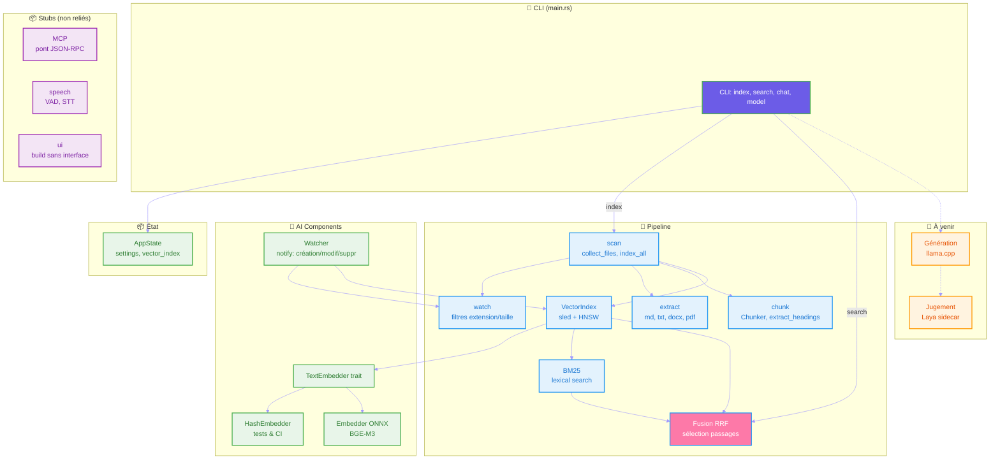
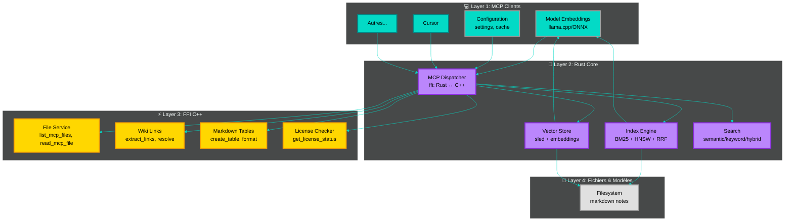
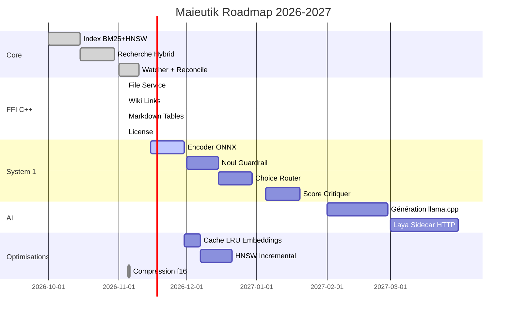
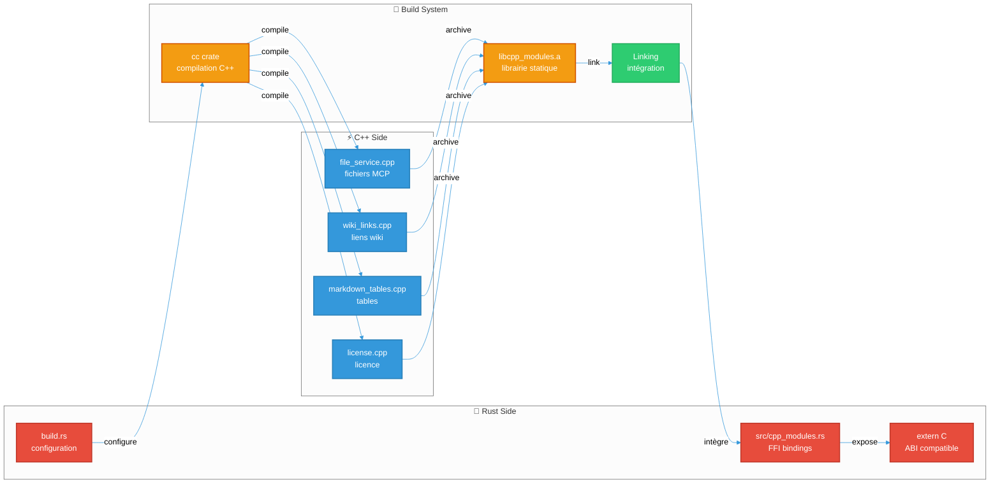

# Maieutik


Prise de notes locale avec IA : indexer ses notes, les retrouver par similarité sémantique et, à terme, reclasser les résultats, générer des réponses sourcées et juger ces réponses. Tout s'exécute localement ; chaque composant externe est placé derrière un trait Rust et choisi par configuration, jamais par le code.

Statut : expérimental. Seules l'indexation et la recherche fonctionnent de bout en bout. Le reste est en stub ou prévu (voir le tableau ci-dessous).

## Architecture rapide

Vue d'ensemble de l'architecture en couches et flux de données :
- Documentation complète : [ARCHITECTURE.md](ARCHITECTURE.md)
- Détail par couches : [docs/ARCHITECTURE_LAYERS.md](docs/ARCHITECTURE_LAYERS.md)

L'architecture suit 5 couches : Frontend → API → Core → FFI → Système. Chaque composant externe est derrière un trait Rust configurable.

## Stack technologique par couche

| Couche | Technologies |
|---|---|
| Frontend | React, TypeScript, Tauri |
| API | Axum, serde, tokio, MCP |
| Core | Rust, sled, fast-hnsw, BM25 |
| FFI | C++ (file_service, wiki_links, markdown_tables, license), cc crate |
| Système | std::fs, notify, onnxruntime, llama.cpp |

## Comment contribuer

1. Fork le dépôt et crée une branche `feat/nom-feature`
2. Respecte la structure en couches ; ajoute/modifie des traits dans `core` si nécessaire
3. Ajoute des tests dans `tests/` avec preuves de fonctionnement
4. Mets à jour la documentation dans `docs/`
5. Lance `cargo check --features cpp-modules` et `cargo test --locked`
6. Ouvre une Pull Request avec description des changements et preuves

Consulte [docs/UTILISATION.md](docs/UTILISATION.md) pour le guide d'utilisation.

## État du projet

| Fonction | Statut | Où |
|---|---|---|
| Indexation par lot (`index`, `--force`) | Implémenté, testé sans modèle | `src/core/scan.rs`, `tests/index_scan.rs` |
| Parcours des dossiers (extensions, taille, liens symboliques ignorés) | Implémenté, testé | `src/core/scan.rs`, `src/core/watch.rs` |
| Recherche (`search`) | Implémenté — `--mode semantic` (dense), `lexical` (BM25) ou `hybrid` (fusion RRF + sélection de passages) ; scores normalisés [0,1] | `src/main.rs`, `src/core/indexer/mod.rs`, `src/core/retrieval/`, `tests/index_search.rs`, `tests/hybrid_search.rs` |
| Index lexical BM25 (k1 = 1.2, b = 0.75) | Implémenté, reconstruit depuis sled comme HNSW ; requête courte et identifiants pondérés (RRF k = 60) | `src/core/retrieval/bm25.rs`, `src/core/retrieval/query.rs`, `src/core/retrieval/fusion.rs`, `src/core/retrieval/passage.rs` |
| Index vectoriel (sled + HNSW) | Implémenté, testé | `src/core/indexer/mod.rs`, `tests/index_replace.rs` |
| Embedder ONNX BGE-M3 (1024 dimensions) | Implémenté ; tests avec modèle rejoués au P1.24 sur l'arbre courant (3 passés, distances identiques à la calibration) | `src/core/indexer/mod.rs`, `src/core/ort_env.rs`, `tests/embedding_search.rs` |
| Faux embedder déterministe (tests, CI) | Implémenté | `src/core/indexer/mod.rs` (`HashEmbedder`) |
| Extraction md, txt, docx | Implémenté, testé | `src/utils/mod.rs`, `tests/docx_extract.rs`, `tests/index_scan.rs` |
| Extraction pdf | Présente ; chaîne corrigée au P1.17 (`pdf-extract 0.12` → `lopdf 0.42`, RUSTSEC-2026-0187 levé), PDF hostile régressé ; non vérifiée sur un corpus réel | `src/utils/mod.rs`, `tests/pdf_extraction.rs` |
| Découpage en chunks | Implémenté, testé ; tailles fixes non calibrées | `src/core/indexer/mod.rs`, `tests/chunker.rs` |
| Surveillance de fichiers (`maieutik --watch`) | Implémentée : création, modification, suppression et renommage réindexent (validation extension + taille fail-closed) ; réconciliation au démarrage qui purge les fichiers disparus et **réindexe les fichiers modifiés** pendant l'arrêt (empreinte taille + mtime stockée dans l'index) ; arrêt sur `SIGINT`/`SIGTERM` qui vide les événements en attente avant de sortir en 0 ; testée sans modèle et de bout en bout avec modèle (`tests/watch_service.rs`, ignoré par défaut). Les fichiers indexés avant l'empreinte restent non vérifiables jusqu'à leur prochaine indexation | `src/core/watch.rs`, `src/core/scan.rs`, `src/lib.rs`, `src/main.rs`, `tests/watcher_reindex.rs`, `tests/watcher_shutdown.rs`, `tests/startup_reconcile.rs`, `tests/watch_service.rs` |
| Génération (llama.cpp) | Stub : jamais exécutée avec un modèle. Le découpage du prompt par lots et le plafonnement de la génération au contexte sont calculés et testés (`plan_decode`), pas encore exercés par une vraie génération | `src/llm/mod.rs` |
| Commandes `chat` et `model` | `model` implémenté (`list`, `download`, `remove`, `status`). `chat` génère via Ollama quand `MAIEUTIK_LLM_MODEL="ollama://<modèle>"` ; `--file CHEMIN` insère le fichier comme contexte (fichier illisible = erreur). Sans générateur configuré : message sur stderr, code 3 — jamais d'echo présenté comme une réponse | `src/main.rs`, `src/llm/mod.rs`, `tests` |
| Pont MCP / JSON-RPC | Transport Unix socket (framing 4 octets LE + JSON, boucle d'accept, socket dans le répertoire privé 0700 de l'utilisateur) et **stdio** (une ligne = une requête) fonctionnels ; `initialize`, `health.check` et les trois méthodes de recherche — `search.semantic`, `search.keyword`, `search.hybrid` — sont acheminées quand le serveur porte l'état applicatif (`McpServer::with_state`, branché par `--mcp-stdio`), avec filtres `folders` / `min_score` et limite bornée à 100. Testé de bout en bout (`tests/mcp_health.rs`, `tests/mcp_search.rs` : serveur réel + client `UnixStream` réel, `HashEmbedder`). Les autres méthodes (`files.*`, `chat.*`, `settings.*`) décrivent le contrat cible et sont refusées en la nommant | `src/mcp/mod.rs`, `src/main.rs`, `tests/mcp_health.rs`, `tests/mcp_search.rs` |
| Voix (VAD, reconnaissance vocale) | Prévu ; stub sans moteur — `sherpa-onnx` (feature `stt`, jamais activée) retiré au P1.19 avec les avis de sécurité qu'il trainait | `src/speech/mod.rs` |
| Interface graphique | Stub : build sans interface | `src/ui/mod.rs` |
| Reclassement, jugement des réponses (Laya, sidecar HTTP), reconnaissance vocale | Prévu | `ARCHITECTURE.md` |

## Architecture



Légende : trait plein = implémenté et relié ; pointillé = partiel, stub ou prévu.

## Commandes

```sh
# Indexer les dossiers configurés
maieutik index [--force]

# Rechercher
maieutik search "requête" [--limit 10] [--mode semantic|lexical|hybrid]

# Mode service : surveille les dossiers jusqu'à SIGINT/SIGTERM
maieutik --watch

# Mode service : pont MCP sur stdio (Odysseus, clients MCP)
maieutik --mcp-stdio

# Factices : message sur stderr, code de sortie 3 (non implémentées)
maieutik chat "message" [--file CHEMIN]
maieutik model list | download NOM | remove NOM | status
```

Les dossiers à indexer se déclarent dans `config.json`, sous `settings.Folders` (liste de chemins). Les clés du bloc `settings` sont en PascalCase (`Folders`, `Extensions`, `MaxFileSize`). **Guide d'utilisation détaillé :** [docs/UTILISATION.md](docs/UTILISATION.md).

### `--watch` (mode service)

`maieutik --watch` garde le processus au premier plan, surveille `settings.Folders` et réindexe créations, modifications, suppressions et renommages. Il s'arrête sur `SIGINT` (Ctrl-C) ou `SIGTERM`, après avoir vidé les événements encore en attente dans la fenêtre de débounce (2 s) : un fichier modifié juste avant l'arrêt est réindexé, puis le processus sort en 0.

- Sans `--watch`, le comportement est inchangé : une commande s'exécute et le processus sort.
- `--watch` refuse de démarrer (code 4) s'il n'y a aucun dossier configuré ou si l'index est indisponible (modèle d'embedding absent ou illisible) : le service ne tourne pas s'il ne peut jamais réindexer.
- `--watch` combiné à une sous-commande ou à `--mcp-stdio` est une erreur d'usage (code 2).
- Au démarrage, l'index est réconcilié : les fichiers supprimés pendant que le service était arrêté en sont retirés, et les fichiers modifiés pendant l'arrêt sont réindexés (l'index stocke l'empreinte taille + date de modification de chaque version indexée, dans un arbre séparé — pas de migration destructrice). HNSW est reconstruit une fois. Un chemin dont les métadonnées sont illisibles est conservé et signalé — la réconciliation ne détruit rien sur une ambiguïté. Un fichier déjà indexé sans empreinte (index antérieur à ce lot) est conservé et signalé jusqu'à sa prochaine indexation.
- Le verrou d'instance unique s'applique : deux `--watch` simultanés ne peuvent pas tourner, y compris depuis des dossiers différents (socket abstrait global ; `MAIEUTIK_INSTANCE_NAME` pour l'isoler).

### `--mcp-stdio` (mode service)

`maieutik --mcp-stdio` lance le pont MCP sur stdio : une ligne JSON-RPC par requête sur stdin, une ligne de réponse sur stdout, aucun diagnostic sur stdout (les journaux vont sur stderr). Le serveur est construit avec l'état applicatif (`McpServer::with_state`) : `initialize`, `health.check`, `search.semantic`, `search.keyword` et `search.hybrid` répondent. Sans index disponible, les méthodes de recherche renvoient une erreur explicite (« index indisponible »), pas une liste vide. `--mcp-stdio` combiné à une sous-commande ou à `--watch` est une erreur d'usage (code 2).

### `index`

- Parcourt les dossiers configurés selon les extensions autorisées et la taille maximale, sans suivre les liens symboliques.
- Un fichier en erreur est journalisé et compté, il n'arrête pas le lot. Un fichier sans texte extractible est signalé sur stderr (« sans texte : chemin ») et compté à part ; un corpus vide donne aussi le code 1. Le résumé final a la forme « N indexé(s), M sans texte, K échec(s) ».
- L'index HNSW est reconstruit une seule fois, à la fin du lot.
- Sans `--force` : chaque fichier trouvé est remplacé sur place ; les fichiers disparus restent dans l'index.
- Avec `--force` : chaque fichier trouvé remplace ses passages, puis les fichiers disparus sont retirés. L'index n'est jamais purgé d'un bloc : un fichier en échec d'extraction garde son ancien contenu et est compté comme échec.
- Taille de chunk : 1200 caractères, recouvrement 150 (valeurs non calibrées).

Codes de sortie :

| Code | Signification |
|---|---|
| 0 | tout est indexé, aucun fichier sans texte, corpus non vide ; ou arrêt propre demandé par `SIGINT`/`SIGTERM` en `--watch` |
| 1 | échec partiel : fichier en échec, fichier sans texte, corpus vide, ou dossier configuré introuvable ou non lisible |
| 2 | erreur d'usage : sous-commande inconnue, `--limit 0`, `--watch` combiné à une sous-commande ou à `--mcp-stdio`, `--mcp-stdio` combiné à une sous-commande |
| 3 | `chat` sans générateur configuré (`MAIEUTIK_LLM_MODEL` absent ou hors `ollama://`) |
| 4 | index indisponible : aucun dossier configuré, aucun dossier lisible, ou modèle d'embedding absent ou illisible (cas de `index`, `search` et `--watch`) |

### `search`

Affiche, pour chaque résultat, un score normalisé `[0, 1]`, le chemin et les 100 premiers caractères du chunk. `--mode` choisit la source : `semantic`/`dense` (HNSW seul, distance euclidienne convertie en similarité cosinus sur vecteurs normalisés L2), `lexical`/`bm25`/`keyword` (BM25 seul, k1 = 1.2, b = 0.75) ou `hybrid` (défaut : fusion RRF des deux listes, k = 60, puis sélection de passages — plancher dense 0.25, quasi-doublons Jaccard 0.92, deux passages par fichier au plus, budget 1200 tokens approximés). Le lexical est pondéré 1.0 par défaut, 1.5 pour une requête de cinq mots ou moins, 2.0 si la requête ressemble à un identifiant de code. Si l'index est indisponible (modèle absent ou illisible), la commande écrit « Index indisponible » sur stderr, laisse stdout vide et sort en code 4. `--limit 0` est refusé avec le code 2.

## Prérequis

Documentés précédemment sur Arch Linux, non rejoués pour cette réécriture : Rust (1.99.1 testé), cmake, clang, pkg-config.

- onnxruntime 1.31.0 (version testée), chargé dynamiquement via `ORT_DYLIB_PATH`.
- Modèle BAAI/bge-m3, export ONNX officiel fp32 : `model.onnx` et `model.onnx_data` (2,27 Go) dans le même dossier, plus `tokenizer.json`. Les empreintes SHA-256 sont dans `VERIFICATION.md`.
- Le modèle n'est nécessaire que pour `index` et `search` en conditions réelles et pour les tests avec modèle. Les tests sans modèle utilisent `HashEmbedder`.

### Variables d'environnement

| Variable | Rôle |
|---|---|
| `MAIEUTIK_EMBEDDER_MODEL` | chemin de `model.onnx` (défaut : `bge-m3/model.onnx` dans le dossier des modèles) |
| `MAIEUTIK_EMBEDDER_TOKENIZER` | chemin de `tokenizer.json` (défaut : `bge-m3/tokenizer.json` dans le dossier des modèles) |
| `MAIEUTIK_EMBEDDER_THREADS` | nombre de threads intra-op (défaut : parallélisme de la machine) |
| `ORT_DYLIB_PATH` | chemin de `libonnxruntime.so` |
| `MAIEUTIK_DOWNLOAD_MODELS` | à la compilation seulement, `1` fait télécharger de petits modèles par `build.rs` (désactivé par défaut) |

## Tests

```sh
# Sans modèle
cargo test --locked

# Avec le modèle réel (nécessite les variables ci-dessus)
cargo test --locked -- --ignored --nocapture --test-threads=1
```

`VERIFICATION.md` décrit ce qui a été exécuté et les empreintes des fichiers. Ses journaux d'archive avec modèle prédatent le P1.5 ; le rejeu des tests d'embedder effectué au P1.24 y est consigné.

## Limites connues

- Surveillance : au démarrage de `--watch`, les fichiers **disparus** pendant l'arrêt sont purgés et les fichiers **modifiés** pendant l'arrêt sont réindexés (empreinte taille + mtime). Un dossier retiré de `settings.Folders` reste indexé jusqu'à `maieutik index --force`, et un fichier indexé avant l'introduction de l'empreinte reste non vérifiable jusqu'à sa prochaine indexation. L'arrêt ordonné et le vidage des événements en attente ne concernent que `--watch` ; sans lui, le processus sort immédiatement et aucun gestionnaire de signal n'est installé (Ctrl-C garde son effet par défaut).
- `model` est implémenté (`list`, `download`, `remove`, `status`). `chat` génère via Ollama quand `MAIEUTIK_LLM_MODEL="ollama://<modèle>"` ; `--file CHEMIN` insère le fichier comme contexte et un fichier illisible est une erreur. Sans générateur configuré, `chat` écrit un message sur stderr et sort en code 3 : il n'affiche jamais le message comme s'il s'agissait d'une réponse.
- La génération n'a jamais chargé de modèle dans cet environnement. Les limites de lot et de contexte sont vérifiées sur le plan de décodage (`plan_decode` : refus d'un prompt vide ou plus long que le contexte, plafonnement à la place restante, découpage par lots de `n_batch`), pas par une génération réelle.
- Le test de retrieval avec modèle (`tests/embedding_search.rs`) couvre 3 requêtes anglaises sur 3 documents ; le retrieval français et interlingue n'est pas testé (phase d'évaluation à venir).
- Découpage : les deux défauts signalés par `ARCHITECTURE.md` (panique sur texte non ASCII avec recouvrement, positions de titres fausses avec CRLF) ont des tests de non-régression dans `tests/chunker.rs`, qui passent. `ARCHITECTURE.md` n'a pas été mis à jour : il décrit encore le découpage comme cassé et `index` comme un stub vide.
- Extraction pdf : RUSTSEC-2026-0187 (`lopdf` 0.34, débordement de pile sur PDF imbriqué) **levé au P1.17** — `pdf-extract 0.12.1` amène `lopdf 0.42`, régressé par `tests/pdf_extraction.rs`. Les avis `zstd`/`zstd-safe` et `zip` (0367 à 0369) sont **levés au P1.19** : retrait de `sherpa-onnx` (feature `stt` jamais activée, seul chemin zstd restant) et montée de la dépendance directe en `zip 9.1.2` (version corrigée). Restent ignorés de façon documentée dans `.cargo/audit.toml` : l'avis `unmaintained` sur `ttf-parser` (via `lopdf`, amont) et les quatre avis liés à `sled`/`bincode`/`tokenizers` en revue P3/P4. Les deux avis sur `failure` (RUSTSEC-2019-0036 et RUSTSEC-2020-0036) sont **levés au P1.26** : `single-instance 0.3.3` ne dépend plus de `failure`.
- Les sorties du modèle sont denses seulement : les sorties sparse et ColBERT de BGE-M3 sont absentes de l'export ONNX utilisé.

## Licence et liens

- Licence : MIT (`LICENSE`)
- Dépôt : https://github.com/chelmooz/maieutik
- Avis tiers : `THIRD_PARTY_NOTICES.md`
---

## 📊 Diagrammes d'Architecture

### Architecture FFI Maieutik-Corrige



### Roadmap Développement



### Dépendances Rust ↔ C++



### 🛠️ Utilisation

Compilation avec FFI C++ :

```bash
cargo build --features cpp-modules
```

Tests :

```bash
cargo test --features cpp-modules
```
