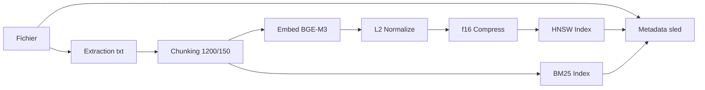
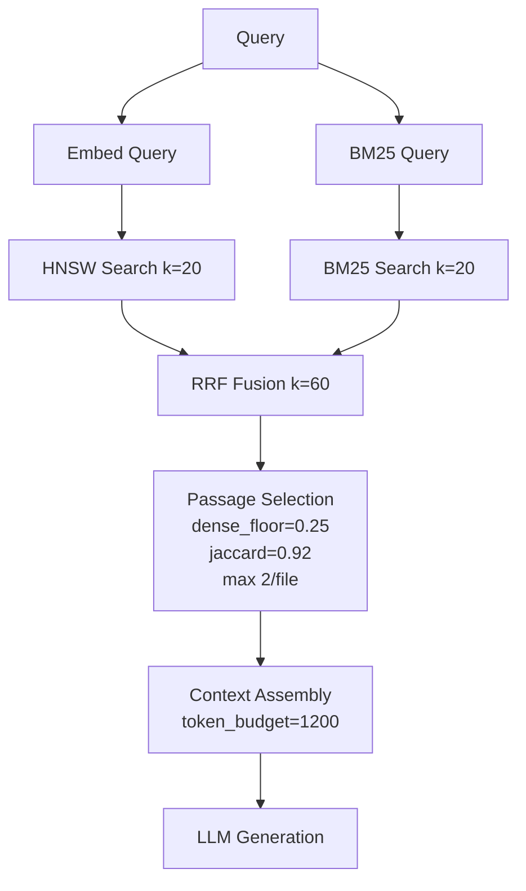

# 🤖 **GUIDE AI ENGINEERS - MAIEUTIK MODÈLES & OPTIMISATION**
**Version:** 2.0 | **Date:** 06 Nov 2026 | **Pour:** AI Engineers

---

## 🧠 **1. MODÈLES SUPPORTÉS**

### **1.1. Embeddings (ONNX Runtime)**

| Modèle | Dim | Taille | Qualité | Statut |
|--------|-----|--------|---------|--------|
| **BGE-M3** (défaut) | 1024 | ~450 MB | ⭐⭐⭐⭐⭐ | ✅ Prod |
| BGE-base | 768 | ~300 MB | ⭐⭐⭐⭐⭐ | ✅ |
| BGE-small | 384 | ~100 MB | ⭐⭐⭐⭐ | ✅ |
| all-MiniLM-L6-v2 | 384 | ~80 MB | ⭐⭐⭐⭐ | ✅ |
| all-mpnet-base-v2 | 768 | ~420 MB | ⭐⭐⭐⭐⭐ | ✅ |

**Constants :** `EMBEDDING_DIM = 1024`, `MODEL_ID = "BAAI/bge-m3"`, `MAX_SEQ_LEN = 8192`

---

### **1.2. LLM (Large Language Models)**

| Modèle | Taille | Quant | Backend | Recommandé |
|--------|--------|-------|---------|------------|
| **Qwen2.5-3B** | 3B | Q4_K_M | **Ollama** (défaut Docker) | ✅ |
| **Mistral-7B** | 7B | Q4_K_M | Ollama / llama.cpp | ✅ |
| Llama-2-7B | 7B | Q4_K_M | Ollama / llama.cpp | ✅ |
| Llama-2-13B | 13B | Q4_K_M | Ollama | ⚠️ +RAM |
| Phi-2 | 2.7B | Q4_K_M | Ollama | ✅ |
| CodeLlama-7B | 7B | Q4_K_M | Ollama | ✅ |

**Backend actif :** `MAIEUTIK_LLM_MODEL=ollama://<modèle>` → HTTP vers `http://localhost:11434`
**llama.cpp local :** Stub (feature future), code dans `src/llm/mod.rs` (plan_decode testé)

---

### **1.3. Reranking (Prévu P4)**

| Modèle | Taille | Intégration |
|--------|--------|-------------|
| BGE-reranker-base | ~300 MB | ONNX |
| BGE-reranker-large | ~1.5 GB | ONNX |
| Flag-reranker | ~500 MB | ONNX |

---

## 📥 **2. INSTALLATION MODÈLES**

### **2.1. Via CLI `maieutik model`**

```bash
maieutik model list                    # Lister installés
maieutik model download bge-m3         # Télécharger embedding
maieutik model status bge-m3           # Statut
maieutik model remove bge-m3 --force   # Supprimer
```

### **2.2. Ollama (LLM)**

```bash
ollama serve                           # Démarrer serveur
ollama pull qwen2.5:3b                 # Modèle par défaut Docker
ollama pull mistral:7b                 # Alternative
ollama list                            # Vérifier
```

### **2.3. Manuel (Embedding)**

```bash
mkdir -p ~/.local/share/maieutik/models
wget https://huggingface.co/BAAI/bge-m3/resolve/main/model.onnx -O ~/.local/share/maieutik/models/bge-m3.onnx
wget https://huggingface.co/BAAI/bge-m3/resolve/main/tokenizer.json -O ~/.local/share/maieutik/models/tokenizer.json
sha256sum ~/.local/share/maieutik/models/bge-m3.onnx
sha256sum ~/.local/share/maieutik/models/tokenizer.json
```

---

### **2.4. Variables d'Environnement**

```bash
# Embedding
MAIEUTIK_EMBEDDER_MODEL=/path/bge-m3.onnx
MAIEUTIK_EMBEDDER_TOKENIZER=/path/tokenizer.json
MAIEUTIK_EMBEDDER_THREADS=4              # Threads ONNX (défaut: nb cœurs)
MAIEUTIK_EMBEDDER_TIMEOUT_SEC=60         # Timeout batch
MAIEUTIK_EMBED_CACHE_SIZE=1000           # Cache LRU embeddings

# LLM
MAIEUTIK_LLM_MODEL=ollama://qwen2.5:3b
MAIEUTIK_LLM_CTX_SIZE=8192
MAIEUTIK_LLM_N_GPU_LAYERS=35
```

---

## ⚡ **3. OPTIMISATION PERFORMANCES**

### **3.1. ONNX Runtime**

- **Optimization Level 3** (max) configuré dans le code
- `MAIEUTIK_EMBEDDER_THREADS` : parallélisme intra-op
- Batch embedding asynchrone : `embed_batch_async` + `embed_async`

### **3.2. Compression f16 (50% RAM)**

```rust
// Dans VectorIndex - stockage vecteurs en half precision (f16)
// Impact: -50% mémoire index, précision négligeable pour recherche
```

### **3.3. Cache LRU Embeddings**

```rust
// maieutik/src/core/embedding_cache.rs
pub struct EmbeddingCache { capacity: usize, ... }
impl EmbeddingCache {
    pub fn stats(&self) -> CacheStats { ... }  // hits, misses, hit_rate, size
}
```
`MAIEUTIK_EMBED_CACHE_SIZE=1000` (défaut). Évite recalculs textes identiques.

---

### **3.4. HNSW (Vector Index)**

| Paramètre | Défaut | Recommandation par taille corpus |
|-----------|--------|----------------------------------|
| `ef_construction` | 200 | 100 (<1k), 200 (1k-10k), 400 (10k-100k), 600 (>100k) |
| `M` | 16 | 8, 16, 24, 32 |
| `ef_search` (runtime) | 100 | 50-200 (précision vs latence) |

**Recherche :** `index.search_mode(query, k, SearchMode::Semantic)` utilise `ef_search` configurable.

---

### **3.5. BM25 Incrémental (P1 - Implémenté)**

```rust
// Mise à jour O(nouvelles chunks) au lieu de rebuild complet
VectorIndex::update_bm25_for_file(&path, chunks)  // Incrémental
VectorIndex::rebuild_hnsw()                       // Rebuild HNSW seul
```

**Parallélisation rayon** dans `scan.rs` :
```rust
files.par_iter().for_each(|f| { /* index_one */ });
// index_one retourne (bool, Vec<Chunk>) pour update BM25
```

---

### **3.6. Chunking**

```rust
// maieutik/src/core/indexer/mod.rs
pub const CHUNK_MAX_CHARS: usize = 1200;
pub const CHUNK_OVERLAP_CHARS: usize = 150;

pub struct Chunker { max_chunk_chars: usize, overlap_chars: usize }
impl Chunker {
    pub fn chunk(&self, content: &FileContent) -> Vec<Chunk> {
        // Découpage par headers + taille fixe + overlap
    }
}
```

---

### **3.7. Benchmarks**

```bash
# CLI search
hyperfine --warmup 3 "maieutik search --query 'test' --k 10"

# Cargo bench
cargo bench

# Résultats attendus (PC correct)
# Index 1k docs: 2-4 min (BGE-M3)
# Recherche sémantique: 50-100ms (k=10)
# Recherche hybride: 80-150ms (k=10)
# Génération LLM: 2-5s (Mistral-7B)
```

---

## 🔧 **4. FINE-TUNING & MODÈLES CUSTOM**

### **4.1. Fine-Tuning BGE-M3 (Python)**

```python
from sentence_transformers import SentenceTransformer, InputExample, losses
from torch.utils.data import DataLoader

model = SentenceTransformer('BAAI/bge-m3')

train_examples = [
    InputExample(texts=["query1", "doc1"], label=1.0),
    InputExample(texts=["query2", "doc2"], label=0.0),
    # ...
]

train_dataloader = DataLoader(train_examples, shuffle=True, batch_size=16)
train_loss = losses.CosineSimilarityLoss(model)

model.fit(
    train_objectives=[(train_dataloader, train_loss)],
    epochs=3, warmup_steps=100,
    output_path="./bge-m3-finetuned"
)
```

### **4.2. Export ONNX**

```python
model.save("./bge-m3-finetuned-onnx", save_format="onnx")
```

### **4.3. Utilisation Custom**

```bash
MAIEUTIK_EMBEDDER_MODEL=/path/bge-m3-finetuned-onnx/model.onnx \
MAIEUTIK_EMBEDDER_TOKENIZER=/path/bge-m3-finetuned-onnx/tokenizer.json \
maieutik index
```

Ou via SDK Rust :
```rust
let embedder = Embedder::new(Path::new("custom.onnx"), Path::new("tokenizer.json"))?;
let index = VectorIndex::open(&data_dir, embedder)?;
```

---

## 📊 **5. ÉVALUATION MODÈLES**

### **5.1. Métriques Cibles**

| Métrique | Cible | Description |
|----------|-------|-------------|
| Accuracy@k | > 80% | % docs pertinents dans top-k |
| MRR | > 0.7 | Mean Reciprocal Rank |
| NDCG@k | > 0.8 | Normalized DCG |
| Latence search | < 100ms | p95 |
| Latence embed | < 50ms/batch | Batch 10 textes |
| RAM index | < 8 GB | 10k docs |

---

### **5.2. Script Évaluation**

```python
# evaluate.py
import requests, numpy as np
from sklearn.metrics import ndcg_score

BASE = "http://localhost:3000"

def search(q, k=10):
    r = requests.get(f"{BASE}/api/search", params={"query": q})
    return [h.split(':')[0] for h in r.json()['hits'][:k]]

queries = ["Maieutik architecture", "comment indexer", "modèles supportés"]
relevant = [
    ["README.md", "ARCHITECTURE.md"],
    ["INSTALLATION.md", "UTILISATION.md"],
    ["README.md", "docs/DEPENDENCIES.md"]
]

accs, ndcgs, mrrs = [], [], []
for q, rel in zip(queries, relevant):
    hits = search(q, 10)
    accs.append(sum(1 for d in rel if d in hits[:10]) / len(rel))
    # NDCG
    ideal = [1.0]*min(len(rel),10) + [0.0]*(10-len(rel))
    actual = [1.0 if h in rel else 0.0 for h in hits[:10]]
    ndcgs.append(ndcg_score([ideal], [actual]))
    # MRR
    for rank, h in enumerate(hits, 1):
        if h in rel: mrrs.append(1.0/rank); break
    else: mrrs.append(0.0)

print(f"Acc@10: {np.mean(accs):.1%}, NDCG@10: {np.mean(ndcgs):.2f}, MRR: {np.mean(mrrs):.2f}")
```

---

## 🏗️ **6. ARCHITECTURE INTERNE (Points Clés)**

### **6.1. Pipeline Indexation**



### **6.2. Pipeline Recherche Hybride**



---

### **6.3. FFI C++ (cpp-modules)**

| Module | Fonction | Sécurité |
|--------|----------|----------|
| `file_service` | Opérations fichiers | `Result` types |
| `wiki_links` | Liens wiki | `Result` |
| `markdown_tables` | Tables MD | `Result` |
| `license` | Détection licence | `Result` |

**Build :** `cargo build --features cpp-modules` (nécessite cmake, clang, pkg-config)

---

## ✅ **CHECKLIST AI ENGINEER**

- [ ] Modèles téléchargés + checksums vérifiés
- [ ] `MAIEUTIK_EMBEDDER_THREADS` tuné (nb cœurs physiques)
- [ ] `ef_construction` / `M` adaptés à la taille corpus
- [ ] Cache LRU monitoring (`EmbeddingCache::stats()`)
- [ ] BM25 incrémental fonctionne (pas rebuild complet à chaque modif)
- [ ] Rayon parallélisation active (`par_iter` dans scan)
- [ ] Fine-tuning pipeline testé si données domaine
- [ ] Évaluation métriques (Acc@k, MRR, NDCG) en place
- [ ] Benchmarks réguliers (`hyperfine`, `cargo bench`)