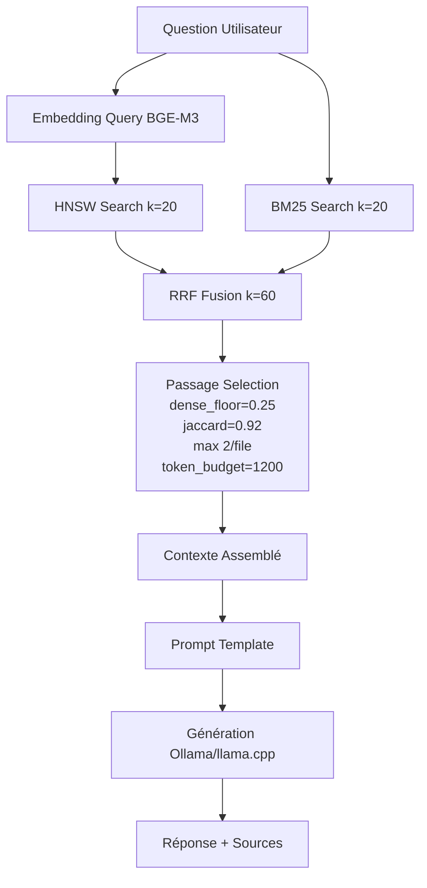

# 📊 **GUIDE DATA SCIENTISTS - MAIEUTIK ANALYSE & DONNÉES**
**Version:** 2.0 | **Date:** 06 Nov 2026 | **Pour:** Data Scientists

---

## 📈 **1. ACCÈS AUX DONNÉES INDEXÉES**

### **1.1. Via SDK Rust (Recommandé)**

```rust
use maieutik::{core::indexer::VectorIndex, config::store::data_dir};

let data_dir = data_dir()?;
let index = VectorIndex::open(&data_dir, HashEmbedder::new())?;

// Stats globales
let (doc_count, meta) = index.stats();
// meta: IndexMeta { schema_version, created_at, file_count, chunk_count, ... }

// Tous les chemins fichiers
let paths: Vec<String> = index.stored_file_paths()?;

// Métadonnées fichiers (fingerprint = taille + mtime)
let files: Vec<(String, Option<FileFingerprint>)> = index.stored_files()?;

// Fingerprint d'un fichier
let fp = index.fingerprint_of("/path/file.md")?;

// Vecteurs + chunks (pour export)
let vectors = index.vector_table()?; // Accès bas niveau sled
```

### **1.2. Pas d'API REST `/api/stats` ni `/api/embeddings`**

> Utiliser le SDK Rust ou écrire un script d'export custom.

---

## 📊 **2. EXPORT & ANALYSE EMBEDDINGS**

### **2.1. Script Export Rust (Exemple)**

```rust
// export_embeddings.rs
use maieutik::{core::indexer::VectorIndex, config::store::data_dir};
use std::fs::File;
use std::io::Write;

fn main() -> Result<(), Box<dyn std::error::Error>> {
    let data_dir = data_dir()?;
    let index = VectorIndex::open(&data_dir, HashEmbedder::new())?;
    
    let mut wtr = csv::Writer::from_path("embeddings_export.csv")?;
    wtr.write_record(&["file_path", "chunk_id", "heading", "text", "vector"])?;
    
    // Itérer tous les vecteurs (accès bas niveau sled)
    // Voir maieutik/src/core/indexer/mod.rs: VectorRecord, VECTOR_TABLE
    
    wtr.flush()?;
    Ok(())
}
```

### **2.2. Visualisation UMAP/t-SNE (Python)**

```python
# visualize.py
import numpy as np
import umap
import matplotlib.pyplot as plt
import pandas as pd

# Charger export CSV
df = pd.read_csv("embeddings_export.csv")
vectors = np.stack(df['vector'].apply(eval).values)  # Si stockés comme strings
# Ou charger .npy si export binaire

# UMAP
reducer = umap.UMAP(n_components=2, random_state=42, n_neighbors=15, min_dist=0.1)
emb_2d = reducer.fit_transform(vectors)

# Plot
plt.figure(figsize=(12, 8))
scatter = plt.scatter(emb_2d[:, 0], emb_2d[:, 1], s=5, alpha=0.6, c=df.index, cmap='viridis')
plt.colorbar(scatter, label='Chunk index')
plt.title("Embeddings BGE-M3 - UMAP 2D")
plt.xlabel("UMAP 1"); plt.ylabel("UMAP 2")
plt.savefig("embeddings_umap.png", dpi=150)

# t-SNE (plus lent, meilleurs clusters locaux)
from sklearn.manifold import TSNE
tsne = TSNE(n_components=2, perplexity=30, random_state=42)
emb_tsne = tsne.fit_transform(vectors[:2000])  # Échantillon si grand
```

---

## 🔍 **3. ANALYSE SIMILARITÉ & CLUSTERING**

### **3.1. Matrice Similarité Queries**

```python
# similarity_analysis.py
import numpy as np
from sklearn.metrics.pairwise import cosine_similarity
import seaborn as sns
import matplotlib.pyplot as plt

queries = [
    "Qu'est-ce que Maieutik?",
    "Comment indexer un document?",
    "Quels modèles d'embedding?",
    "Architecture technique",
    "Déploiement Docker"
]

# Obtenir embeddings via SDK Rust (export) ou approximation
# Ici: exemple avec embeddings simulés
embeddings = np.random.rand(len(queries), 1024)  # REMPLACER par vrais embeddings

sim_matrix = cosine_similarity(embeddings)

plt.figure(figsize=(10, 8))
sns.heatmap(sim_matrix, xticklabels=queries, yticklabels=queries, 
            annot=True, fmt='.2f', cmap='coolwarm', center=0.5)
plt.title("Similarité Cosinus entre Requêtes")
plt.tight_layout()
plt.savefig("query_similarity.png")
```

### **3.2. Clustering Documents (KMeans / HDBSCAN)**

```python
# clustering.py
from sklearn.cluster import KMeans
import hdbscan
import numpy as np

# vectors: (n_chunks, 1024)
# KMeans
kmeans = KMeans(n_clusters=10, random_state=42, n_init=10)
labels = kmeans.fit_predict(vectors)

# HDBSCAN (meilleur pour densité variable)
clusterer = hdbscan.HDBSCAN(min_cluster_size=10, min_samples=5)
labels = clusterer.fit_predict(vectors)

# Analyser clusters
for cluster_id in np.unique(labels):
    if cluster_id == -1: continue  # Noise
    mask = labels == cluster_id
    cluster_vectors = vectors[mask]
    centroid = cluster_vectors.mean(axis=0)
    # Trouver chunks les plus représentatifs
    sims = cosine_similarity([centroid], cluster_vectors)[0]
    top_idx = np.argsort(sims)[-3:][::-1]
    print(f"Cluster {cluster_id}: {mask.sum()} chunks")
```

---

## 🤖 **4. PIPELINE RAG (Retrieval-Augmented Generation)**

### **4.1. Architecture RAG Maieutik**



### **4.2. Paramètres RAG (Code - Non Configurables Fichier)**

```rust
// maieutik/src/core/retrieval/passage.rs
pub const DENSE_FLOOR_SIMILARITY: f32 = 0.25;  // Seuil min similarité dense
pub const JACCARD_THRESHOLD: f32 = 0.92;        // Déduplication passages
pub const PASSAGES_PER_FILE: usize = 2;         // Max passages par fichier
pub const TOKEN_BUDGET: usize = 1200;           // Budget tokens contexte

// maieutik/src/core/retrieval/fusion.rs
pub const RRF_K: u32 = 60;  // Lissage RRF
```

### **4.3. Évaluation RAG**

```python
# evaluate_rag.py
import requests, json

BASE = "http://localhost:3000"

def rag_query(question: str):
    r = requests.post(f"{BASE}/chat", json={
        "messages": [{"role": "user", "content": question}]
    })
    return r.json()

test_cases = [
    {
        "question": "Qu'est-ce que Maieutik?",
        "expected_keywords": ["local-first", "notes", "IA", "indexer", "recherche"]
    },
    {
        "question": "Comment indexer un document?",
        "expected_keywords": ["maieutik index", "fichier", "répertoire", "--force"]
    },
    {
        "question": "Quels modèles d'embedding?",
        "expected_keywords": ["BGE-M3", "ONNX", "1024", "embedding"]
    }
]

for tc in test_cases:
    resp = rag_query(tc["question"])
    answer = resp.get("message", {}).get("content", "").lower()
    found = sum(1 for kw in tc["expected_keywords"] if kw.lower() in answer)
    score = found / len(tc["expected_keywords"])
    print(f"Q: {tc['question']}")
    print(f"Score: {score:.1%} ({found}/{len(tc['expected_keywords'])})")
    print(f"A: {answer[:200]}...")
    print()
```

---

## 📏 **5. MÉTRIQUES & MONITORING**

### **5.1. Métriques Clés à Suivre**

| Métrique | Source | Cible | Alerte |
|----------|--------|-------|--------|
| Index size (MB) | `IndexMeta` | < 500 MB (10k docs) | > 1 GB |
| Chunk count | `IndexMeta` | Cohérent vs nb docs | Chute brutale |
| Avg chunks/doc | Calcul | ~5-10 | > 20 |
| Search latency p95 | Logs / custom | < 100ms | > 200ms |
| Embed latency p95 | Logs / custom | < 50ms/batch | > 100ms |
| Cache hit rate | `EmbeddingCache::stats()` | > 70% | < 50% |
| Index freshness | `FileFingerprint.mtime` | < 1h | > 24h |

### **5.2. Dashboard Grafana (Suggestion)**

```json
{
  "panels": [
    {"title": "Index Size (MB)", "targets": [{"expr": "maieutik_index_size_bytes / 1e6"}]},
    {"title": "Documents Indexés", "targets": [{"expr": "maieutik_index_documents"}]},
    {"title": "Search Latency p95", "targets": [{"expr": "histogram_quantile(0.95, rate(maieutik_search_duration_ms_bucket[5m]))"}]},
    {"title": "Embedding Latency p95", "targets": [{"expr": "histogram_quantile(0.95, rate(maieutik_embed_duration_ms_bucket[5m]))"}]},
    {"title": "Cache Hit Rate", "targets": [{"expr": "rate(maieutik_cache_hits[5m]) / (rate(maieutik_cache_hits[5m]) + rate(maieutik_cache_misses[5m]))"}]}
  ]
}
```

> **Note :** Métriques Prometheus non exposées nativement. À instrumenter via `tracing` + `prometheus-client` si besoin.

---

## 🧪 **6. EXPÉRIMENTATION & A/B TESTING**

### **6.1. Comparer Modèles Embedding**

```rust
// Comparer BGE-M3 vs BGE-base vs custom
let models = vec![
    ("bge-m3", "/path/bge-m3.onnx", "/path/tokenizer.json"),
    ("bge-base", "/path/bge-base.onnx", "/path/tokenizer.json"),
];

for (name, model_path, tok_path) in models {
    let embedder = Embedder::new(Path::new(model_path), Path::new(tok_path))?;
    let index = VectorIndex::open(&data_dir, embedder)?;
    
    // Benchmark recherche
    let start = std::time::Instant::now();
    let _ = index.search_mode("test query", 10, SearchMode::Hybrid).await?;
    println!("{}: {:?}", name, start.elapsed());
    
    // Évaluation qualité (voir evaluate.py)
}
```

### **6.2. Tuner Paramètres RAG**

```rust
// Expérimenter dense_floor, jaccard, passages_per_file, token_budget
// Modifier dans passage.rs puis rebuild

// Ou créer Retriever custom avec params configurables
struct CustomRetriever {
    dense_floor: f32,
    jaccard_thresh: f32,
    max_per_file: usize,
    token_budget: usize,
}
```

---

## ✅ **CHECKLIST DATA SCIENTIST**

- [ ] Export embeddings fonctionnel (script Rust → CSV/Parquet)
- [ ] Visualisation UMAP/t-SNE réalisée
- [ ] Matrice similarité queries analysée
- [ ] Clustering documents testé (KMeans/HDBSCAN)
- [ ] Pipeline RAG évalué (Accuracy@k, MRR, NDCG)
- [ ] Métriques monitoring définies + alertes
- [ ] A/B testing modèles embedding documenté
- [ ] Paramètres RAG tunés pour domaine
- [ ] Documentation expériences partagée